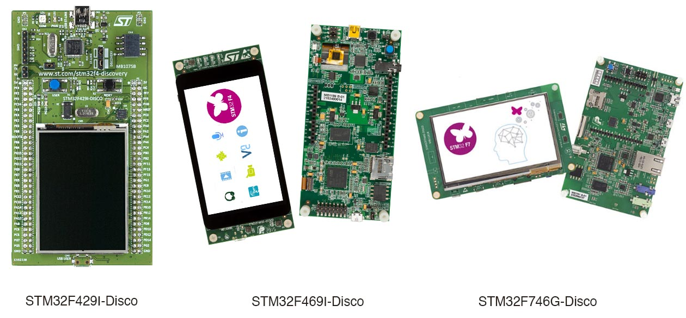

.. Copyright (C) 2026, AdaCore

Porting a runtime to a Cortex-M board
=====================================

The STM32F469I-Discovery and STM32F746G-Discovery boards already have runtime
support in bb-runtimes. This tutorial treats their board target definitions
as if they did not exist. You will use the `extender template
<https://github.com/AdaCore/bb-runtimes-extender-template>`_ to create your own
STM32F469 target, then review the changes needed for STM32F746.

The exercise reuses shared Cortex-M and STM32 components. Existing board
sources provide reference implementations that you copy into your project.
For a board without existing support, you must supply those implementations
from its hardware documentation.

Prepare the template checkout
-----------------------------

Complete the installation steps in the `template README
<https://github.com/AdaCore/bb-runtimes-extender-template#readme>`_.
Run all commands below from the template checkout, with its Python environment
active. Keep the ``BB_RUNTIMES`` and ``RUNTIME_SOURCES_FROM_GNAT_INSTALL_DIR``
variables from that setup.

For this exercise, set ``RUNTIME_SOURCES_FROM_GNAT_INSTALL_DIR`` to the original
GNAT runtime source bundle for Light-Tasking. A built Light runtime directory
does not contain all the sources this port requires. Preserve the bundle's
source filenames and subdirectories. Each declared source path must exist
under one of the directories passed with ``--source-search-path``.
See :doc:`end_users_guide` for source search paths.

Record your working directory:

.. code-block:: sh

   export TEMPLATE="$PWD"

Use the repositories as follows:

.. list-table::
   :header-rows: 1
   :widths: 25 75

   * - Checkout
     - Role in this exercise
   * - ``$TEMPLATE``
     - Contains every file you create or edit, and the generated runtime.
   * - ``$BB_RUNTIMES``
     - Supplies the infrastructure, shared components, and reference sources.

The template contains two Cortex-M3 examples. This exercise adds a third target
in ``example_runtimes/discovery.py``. It uses the same package and entry point,
with STM32 board support and a Light-Tasking profile.
See :doc:`extending_with_your_own_target` for the component and target APIs.

Prepare your board sources
--------------------------

These boards already have working implementations. Copy them into your project
so you can adapt the board support independently.
For another board, you would typically implement these files from its hardware
documentation and reuse only the parts that match its MCU and peripherals.

Create a local source directory and copy the files for this exercise:

.. code-block:: sh

   export PORT_SOURCES=sources/stm32f469_port
   mkdir -p "$PORT_SOURCES/svd"
   cp "$BB_RUNTIMES/src/arm/stm32/stm32f469x/s-bbmcpa.ads" \
       "$BB_RUNTIMES/src/arm/stm32/stm32f469x/s-bbmcpa.adb" \
       "$BB_RUNTIMES/src/arm/stm32/stm32f429x/s-stm32.adb" \
       "$BB_RUNTIMES/src/arm/stm32/s-bbbopa.ads.tmpl" \
       "$BB_RUNTIMES/src/arm/stm32/common-ROM.ld" \
       "$BB_RUNTIMES/src/arm/stm32/common-RAM.ld" \
       "$BB_RUNTIMES/src/arm/stm32/stm32f469x/memory-map.ld" \
       "$PORT_SOURCES/"
   cp "$BB_RUNTIMES/src/arm/stm32/stm32f469x/svd/"* "$PORT_SOURCES/svd/"

The STM32F469 reference uses the ``s-stm32.adb`` implementation shared with
STM32F429. The other files describe the selected MCU, its registers and
interrupts, board parameters, and memory allocation.

Review memory and hardware configuration
----------------------------------------

Edit files under ``sources/stm32f469_port/``. The corresponding files in
``$BB_RUNTIMES/src/arm/stm32/`` remain references.

Memory allocation
~~~~~~~~~~~~~~~~~

``memory-map.ld`` declares these STM32F469 regions:

.. code-block:: text

   MEMORY
   {
     flash   (rx)  : ORIGIN = 0x08000000, LENGTH = 2048K
     sram123 (rwx) : ORIGIN = 0x20000000, LENGTH = 320K
     ccm     (rw)  : ORIGIN = 0x10000000, LENGTH = 64K
   }

Check the MCU's memory sizes and the board's memory connections. Preserve the
region aliases used by ``common-ROM.ld`` and ``common-RAM.ld``. Register the
memory map as an included script and the selected common script as an entry
script. Passing both as entry scripts can define sections twice.

Peripherals and interrupts
~~~~~~~~~~~~~~~~~~~~~~~~~~

The copied ``svd/`` directory contains Ada register bindings, interrupt names
in ``a-intnam.ads``, and vectors in ``handler.S``. Check these against the MCU's
interrupt parameters in ``s-bbmcpa.ads``.
This implementation depends on those Ada and assembly sources. The directory
name does not require you to use an SVD file or a generator.

For another MCU, write the register bindings yourself or use
`SVD2Ada <https://github.com/AdaCore/svd2ada>`_ to generate them from its
CMSIS-SVD description. Check the bindings against the MCU reference manual.

Clocks and power
~~~~~~~~~~~~~~~~

``s-bbbopa.ads.tmpl`` defines board parameters used by shared STM32 clock code.
The target below supplies the STM32F469 reference values: a 180 MHz system
clock, an 8 MHz HSE clock, and flash latency 5. Check the board's HSE source,
PLL settings, bus frequencies, and flash latency before changing these values.

Review the shared ``$BB_RUNTIMES/src/arm/stm32/setup_pll.adb`` and the local
``s-bbmcpa.adb`` for voltage scaling and power initialization. Consult ST's
RM0386 and board manual UM1932 for the selected hardware. Copy a shared source
into your project and select that copy if your port needs a different
implementation.

Define the board component and target
-------------------------------------

Create ``example_runtimes/discovery.py`` with this board component:

.. code-block:: python

   from pathlib import Path
   from typing import override

   from bb_runtimes_targets_gen.concrete_infrastructure.profile_factories import (
       light_tasking_profile,
   )
   from bb_runtimes_targets_gen.targets.arm.cortexm import (
       ArmV7MTarget,
       Stm32CommonArchSupport,
   )
   from rts_prebuilder.abstract_infrastructure import (
       AbstractTarget,
       Loader,
       Profile,
       SourcesAndFlagsComponent,
   )

   class DiscoveryBoardSupport(SourcesAndFlagsComponent):
       @override
       def contribute(self, target: AbstractTarget, profile: Profile) -> None:
           root = "stm32f469_port"
           self.add_gnat_sources(
               f"{root}/s-bbmcpa.ads",
               f"{root}/s-bbmcpa.adb",
               f"{root}/s-bbbopa.ads.tmpl",
               f"{root}/s-stm32.adb",
               f"{root}/svd/i-stm32.ads",
               f"{root}/svd/i-stm32-flash.ads",
               f"{root}/svd/i-stm32-gpio.ads",
               f"{root}/svd/i-stm32-pwr.ads",
               f"{root}/svd/i-stm32-rcc.ads",
               f"{root}/svd/i-stm32-syscfg.ads",
               f"{root}/svd/i-stm32-usart.ads",
           )
           self.add_gnarl_sources(
               f"{root}/svd/a-intnam.ads",
               f"{root}/svd/handler.S",
           )
           for name in ("ROM", "RAM"):
               self.add_loaders(
                   Loader(
                       name,
                       linker_scripts=(Path(f"{root}/common-{name}.ld"),),
                       included_scripts=(Path(f"{root}/memory-map.ld"),),
                   )
               )

The paths are relative to the ``sources/`` search directory. Each selected
file enters the generated runtime. A file's presence in ``sources/`` alone
does not select it.

Append the target class to the same file:

.. code-block:: python

   class DiscoveryPort(ArmV7MTarget):
       def __init__(self) -> None:
           super().__init__()
           self.add_dependency(Stm32CommonArchSupport())
           self.add_dependency(DiscoveryBoardSupport())
           for key, value in {
               "Board_Name": "discovery-f469-port",
               "STM32_Main_Clock_Frequency": "180_000_000",
               "STM32_HSE_Clock_Frequency": "8_000_000",
               "STM32_FLASH_Latency": "5",
           }.items():
               self.add_template_config_value(key, value)

       @property
       @override
       def name(self) -> str:
           return "discovery-f469-port"

       @property
       @override
       def has_fpu(self) -> bool:
           return True

       @property
       @override
       def use_semihosting_io(self) -> bool:
           return True

       @property
       @override
       def profiles(self) -> list[Profile]:
           return [light_tasking_profile(self, Path("system-xi-cortexm4-sfp.ads"))]

       @override
       def contribute(self, target: AbstractTarget, profile: Profile) -> None:
           switches = (
               "-mlittle-endian",
               "-mthumb",
               "-mcpu=cortex-m4",
               "-mfloat-abi=hard",
               "-mfpu=fpv4-sp-d16",
           )
           self.add_runtime_switches(common_switches=switches)
           self.add_app_switches(common_switches=switches)

``ArmV7MTarget`` supplies architecture properties. ``Stm32CommonArchSupport``
selects shared startup and clock code, plus Cortex-M reset and tasking
support through its dependencies. ``DiscoveryBoardSupport`` selects your local
MCU and board files. The profile factory supplies the Light-Tasking component
set and selects its ``system.ads``. ``use_semihosting_io`` selects semihosting
text I/O through that component set.

These are the same two component routes used by the template: dependencies
for target support, and ``Profile.components`` for the profile's source set.
A directly constructed ``Profile`` must supply its components explicitly.
Setting ``base_profile`` alone does not populate that list.

Register and generate your target
---------------------------------

Add this import to ``example_runtimes/__main__.py``:

.. code-block:: python

   from .discovery import DiscoveryPort

Add ``DiscoveryPort()`` to the existing ``RuntimePrebuilderCLI.register_targets``
call, alongside the two template targets. Generate your local target:

.. code-block:: sh

   python -m example_runtimes discovery-f469-port \
       --source-search-path sources \
       --source-search-path "$BB_RUNTIMES/src" \
       --source-search-path "$RUNTIME_SOURCES_FROM_GNAT_INSTALL_DIR" \
       --output-dir generated

The result is ``generated/light-tasking-discovery-f469-port/``. Inspect its
``gnat/s-bbbopa.ads``, ``gnarl/handler.S``, and ``ld/memory-map.ld`` to check the
selected configuration. Add ``--overwrite`` when you generate it again.
See :doc:`end_users_guide` for the generated directories and build options.

The matching GNAT installation's ``bin`` directory and ``gprbuild`` must be on ``PATH``:

.. code-block:: sh

   python generated/light-tasking-discovery-f469-port/build.py

``build.py`` compiles the runtime library. It does not build an application.

Build an application against your port
--------------------------------------

Create ``applications/port_check/`` in the template checkout. Add this
``main.adb`` to exercise the clock through ``Ada.Real_Time``:

.. code-block:: ada

   with Ada.Real_Time; use Ada.Real_Time;

   procedure Main is
      Next       : Time := Clock;
      Tick_Count : Natural := 0 with Volatile;
   begin
      loop
         Next := Next + Milliseconds (100);
         delay until Next;
         Tick_Count := Tick_Count + 1;
      end loop;
   end Main;

Add ``applications/port_check/port_check.gpr``:

.. code-block:: ada

   project Port_Check is
      for Main use ("main.adb");
      package Compiler is
         for Default_Switches ("Ada") use ("-g");
      end Compiler;
   end Port_Check;

Build it against your runtime with the RAM loader:

.. code-block:: sh

   gprbuild --target=arm-eabi \
       --RTS="$TEMPLATE/generated/light-tasking-discovery-f469-port" \
       -XLOADER=RAM -P applications/port_check/port_check.gpr

``gprbuild`` compiles and links the application. Load its executable with your
board debugger. Check that ``Tick_Count`` increases at the expected rate.
Check memory, interrupts, and peripheral behavior on the board as you extend
the port. The selected semihosting I/O requires debugger support if your
application uses console output.

Adapt the exercise to STM32F746
-------------------------------

Create a separate local target and source directory for STM32F746. Use the
``stm32f7x/`` MCU files and bindings as references, including its
``s-stm32.adb`` and memory map. Register the new target in the same entry point.

Update the CPU switches to ``-mcpu=cortex-m7`` and ``-mfpu=fpv5-sp-d16``.
The STM32F746 reference configuration uses a 200 MHz system clock, a 25 MHz
HSE clock, and flash latency 5. Check those settings against the selected board.

Review the shared ``$BB_RUNTIMES/src/arm/stm32/start-common.S``. Its Cortex-M7
path invalidates and enables caches and configures ITCM and DTCM. Match startup
initialization to the local memory map, which separates ITCM, flash, DTCM,
and SRAM. Use the Arm Cortex-M7 Technical Reference Manual for your core
revision when you change this sequence.

Generate and build the new target through ``python -m example_runtimes`` and
its generated ``build.py``. Build the application against that runtime's
absolute path, as in the STM32F469 exercise.
